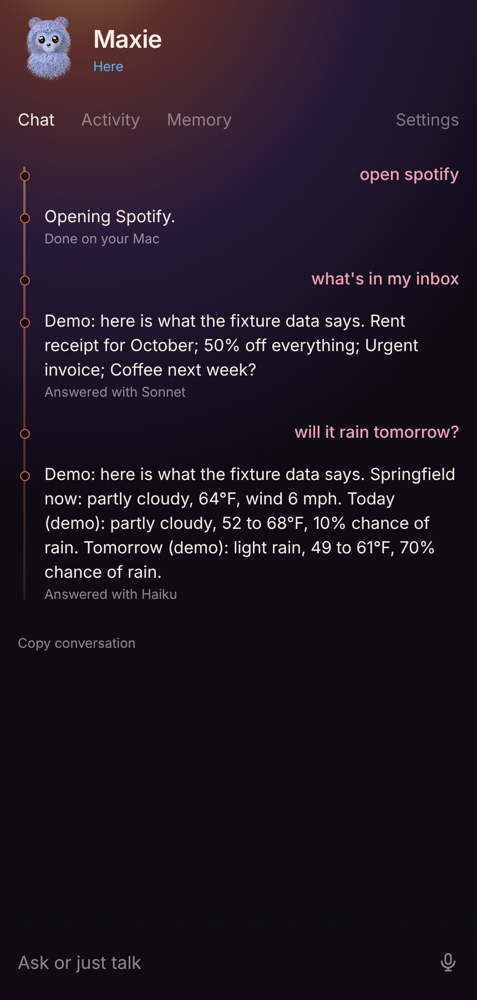
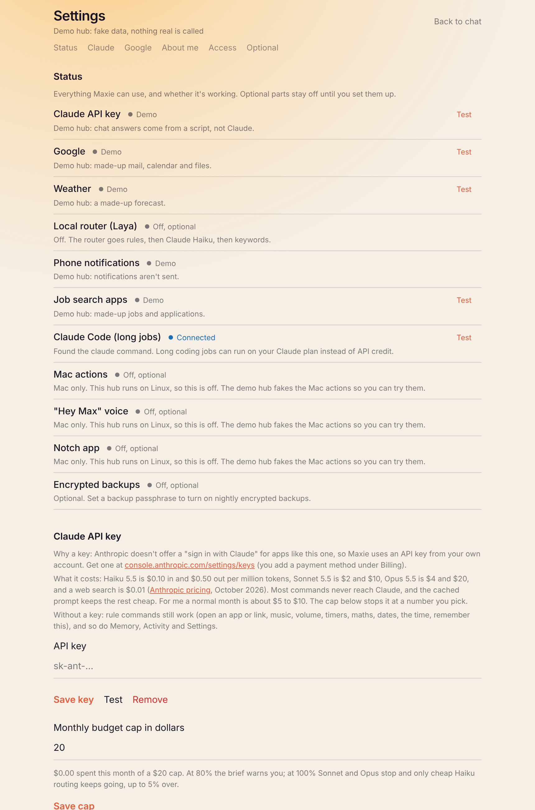
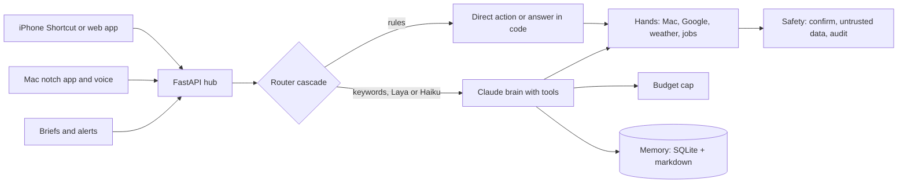
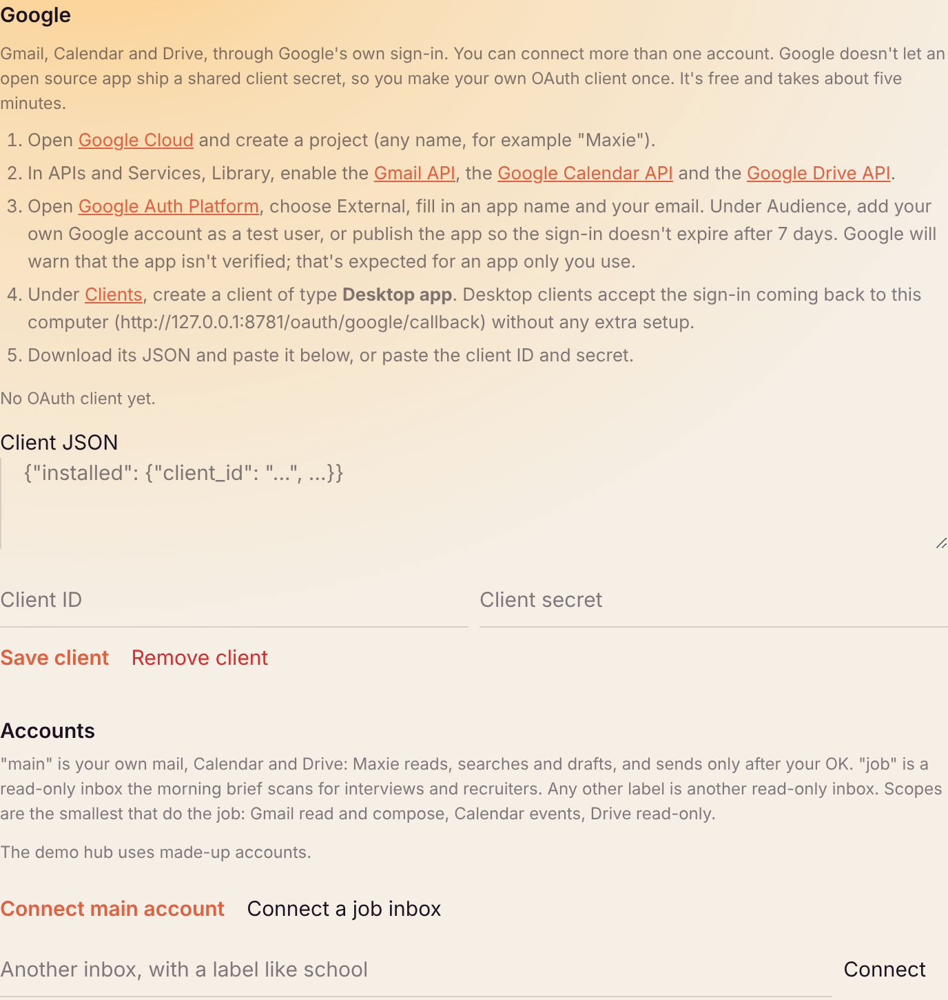

# Maxie

Built in October 2026 as my own assistant. This is the public version, with my personal accounts, memory and data removed.

Maxie is a voice assistant for the Mac and the iPhone. You talk to it ("Hey Max, what's on my calendar?",
"open Spotify", "draft a reply to the landlord"), and it answers out loud, acts on your computer, reads your
Gmail and Calendar, and warns you ahead of time (a morning brief, an evening wrap, a heads-up before a
meeting). It runs on one monthly API budget with a hard cap, and anything that sends, deletes, pays or
invites waits for your OK.

I built it because every assistant I tried either did nothing (it only talked) or did too much without
asking. I wanted something that opens the app I asked for in under a millisecond without paying for a model
call, uses Claude only when a request actually needs thinking, and never sends an email on its own. I was
in the middle of a job search at the time, so it also talks to two job-search apps I wrote. Those are
optional here and off by default.



## What's in here

- A FastAPI hub (`maxie/hub/api.py`) that everything talks to: the web app, the iPhone Shortcut, the Mac
  notch app and the voice helper.
- A router cascade that decides what each command is, cheapest step first (`maxie/router/`).
- A Claude "brain" with a tool loop, streaming and prompt caching, on Haiku, Sonnet or Opus (`maxie/brain.py`).
- The "hands": Mac actions through `open`, AppleScript and Shortcuts, Gmail for as many accounts as you
  connect, Google Calendar and Drive, weather, the two job-search apps, and handing long jobs to `claude -p`
  (`maxie/hands/`).
- A monthly budget cap (`maxie/budget.py`), a safety layer (`maxie/safety.py`), memory in SQLite with a
  readable markdown page (`maxie/memory.py`) and proactive briefs (`maxie/proactive.py`).
- A home-screen web app in `web/` with chat, Activity, Memory and a Settings page with a live status panel.
- An optional Swift notch app in `mac/ClaudeNotch/` and launchd services in `deploy/` (macOS only).
- Evals in `evals/` and `maxie/evals*.py`, and about 650 tests in `tests/`.

## Quickstart

You need Python 3.12 or newer and [uv](https://docs.astral.sh/uv/).

```sh
git clone https://github.com/vijayyarabolu/maxie-assistant.git
cd maxie-assistant
make install
```

Try it with no accounts and no keys first:

```sh
make demo        # http://127.0.0.1:8781, passcode demo1234
```

The demo hub fakes Google, the job apps and the Mac, and a small script stands in for Claude, so you can
click through everything offline. It keeps its data in `~/.maxie-demo`, never in your real folder.

Then run the real one:

```sh
make run         # http://127.0.0.1:8780
```

1. Open http://127.0.0.1:8780 on the same computer. The first visit asks you to pick a passcode. That only
   works from this computer, so nobody else on your network can claim a fresh hub.
2. You land on Settings. The status panel at the top lists every part as Connected, Missing, Failing or
   Off, each with a Test button.
3. Paste your Claude API key (see Costs for why it's a key and what it costs). Press Test.
4. Set your city under About me. Weather, the clock and the morning brief use it.
5. If you want mail and calendar, follow the numbered steps under Google to make your own OAuth client,
   then press Connect main account. Add more accounts the same way.
6. For the phone, make an app token under Access and follow [docs/iphone.md](docs/iphone.md).

Settings and keys live in `~/.maxie` on your computer (`settings.json`, and `secrets.json` with mode 0600).
Nothing you enter goes into the repo. An environment variable with the same name, like `ANTHROPIC_API_KEY`,
wins over the file, and Settings says which one is in use.



## How it works



### The router cascade

Every command goes through four steps, and it stops at the first one that is sure:

1. `rules.py`: regexes for the everyday commands. Open an app or a link, play or pause music, volume,
   timers, maths, dates, the time, remember this, stop. These answer in well under a millisecond with no
   model call at all, and maths and dates are always done in code, never by a model.
2. `lexicon.py`: keyword scores. When it is confident (0.6 or more), its route is used as is.
3. `laya.py`: an optional local classifier, [Laya](https://pypi.org/project/laya/), that gives a typed
   decision with a probability. It's free and private. Its route only counts above a per-route threshold
   found by calibrating on your own labelled commands (the Activity tab lets you fix wrong routes).
4. `haiku.py`: Claude Haiku decides when the earlier steps couldn't.

Why bother: most of what I say to an assistant is "open Slack" or "set a timer for ten minutes". Sending
that to a model is slow and costs money every time. On the 120-command eval set, 108 commands (90%) are
routed with no model call at all (34 by the rules, 74 by confident keywords), and 36 of them (30%) finish
without any LLM call because they are harmless direct actions or answers computed in code. Only 12 need
Laya or Haiku to decide where they go.

When a command does need Claude, the route picks the model: Haiku for quick questions and one-step Mac
actions, Sonnet for real tasks with tools, Opus only when you say "think hard". The system prompt, the tool
list and your memory page are cached prompt prefixes; the clock goes in the user turn so it never breaks
the cache. A tiny warm-up keeps Haiku's cache alive during waking hours.

### The budget cap

Spend is counted from the `usage` on every response, with cache reads and writes priced separately
(`maxie/budget.py`). You set a monthly cap in Settings (default $20). At 80% the morning brief warns you.
At 100% Sonnet and Opus stop; Haiku keeps routing and doing direct actions up to a 5% overdraft, and then
the hub answers in plain text that the budget is reached. If a newer model shows up before its price is in
the table, it's counted at the dearest known price for its tier times 1.5, so the cap never under-counts.

### The safety model

- Every tool has a kind. `read` and `action` tools run. `send`, `delete`, `pay`, `submit`, `invite` and `run`
  tools never run directly: they become a confirmation card that only you can approve, in the web app, the
  notch panel or the phone. Settings › Rules lets you make any tool allow, ask or block.
- Email bodies, web pages, file contents and Messages are wrapped as `<untrusted_data>` before the model
  sees them. The prompt says that text is data, never instructions, and anything risky requested after
  reading it is flagged on the confirm card. The demo inbox has a prompt-injection email in it on purpose;
  `tests/test_safety.py` checks nothing gets sent.
- Everything goes into an audit log (Activity tab). Keys and tokens never do.
- "Max, stop" and the Stop button kill the current task at the next step.
- Memory refuses passwords, keys, ID numbers, health and immigration details, and only stores what you said
  yourself, in your words.
- Job applications are never submitted. There is no tool for it.

### Logins

- Browsers: a passcode you set on first run, then a session cookie (HttpOnly, SameSite=Strict, Secure over
  HTTPS, 30 days, rotated daily, revocable in Settings). The passcode is stored as an scrypt hash.
- Apps that can't show a sign-in page, like the iPhone Shortcut, use an app token you make in Settings.
  It's shown once, only its hash is stored, and you can revoke it.
- Google is a real "Connect Google" flow: OAuth 2.0 authorization code with PKCE (S256), redirecting back to
  the hub's own port (`http://127.0.0.1:8780/oauth/google/callback`), minimal scopes, access tokens
  refreshed a minute before they expire, and Disconnect revokes the token at Google. You can connect as
  many accounts as you like, each with a label: `main` gets Gmail read and compose, Calendar events and
  Drive read-only; `job` and any other label get read-only Gmail.

Google doesn't allow an open source app to ship a shared OAuth client secret, so you create your own client
once (a "Desktop app" client, free, about five minutes). Settings has the numbered steps with links. While
your Google app is in Testing mode, Google expires the refresh token after 7 days; publishing it (for your
own use, unverified) avoids that.



## Costs

What needs a key, and why:

| Service | Why a key | Where to get it | What it costs |
|---|---|---|---|
| Claude API | Anthropic has no "sign in with Claude" for third-party apps, so Maxie uses your API key | [console.anthropic.com/settings/keys](https://console.anthropic.com/settings/keys) | Pay as you go, see below |
| Google | Not a key: OAuth, with your own client | [Google Cloud console](https://console.cloud.google.com/auth/clients) | Free for personal use (normal API quotas) |
| Weather | No key at all | [Open-Meteo](https://open-meteo.com/) | Free for non-commercial use, under 10,000 calls a day ([terms](https://open-meteo.com/en/terms)); data is CC BY 4.0 |
| Laya (optional) | A key for your own local server; `make laya` makes one | runs on your computer | Free; a 421M-parameter model you download from Hugging Face |
| Job search apps (optional) | Their own LAN tokens | your own jobhunt and resumegen | Free |

Claude prices from [Anthropic's pricing page](https://platform.claude.com/docs/en/about-claude/pricing),
checked October 19, 2026, per million tokens:

| Model | Input | Output | Cache read | Used for |
|---|---|---|---|---|
| Haiku 5.5 | $0.10 | $0.50 | $0.01 | routing, quick answers, one-step actions |
| Sonnet 5.5 | $2 | $10 | $0.10 | real tasks with tools |
| Opus 5.5 | $4 | $20 | $0.20 | only on "think hard" |

Web search is $10 per 1,000 searches. Anthropic bills monthly in arrears and has no ongoing free tier;
some new accounts get a small trial credit in the Console, so check your Billing page.

A realistic month for everyday use, by my estimate: 40 commands a day, where about a third are rule
commands (free), around 10 are Haiku turns (about $0.0003 each with a warm cache), and about 5 are Sonnet
tasks of three tool steps (about $0.04 each). Add a morning brief and two or three web searches a day. That
comes to roughly $5 to $10 a month. Heavy use with long tool chains or Opus can reach $20 to $30, which is
why the cap exists. For a sense of scale, a full run of the 20-question live eval cost $0.15 and the
40-task usefulness eval cost $0.12.

What works with no Claude key: the rule commands (open apps and links, music, volume, timers, maths, dates,
the time, remember and forget), Memory, Activity, Settings, push notifications and the briefs' calendar and
mail sections. Anything that needs Claude answers with one line saying a key is missing.

## Evals and tests

All numbers below are from real runs.

- Router eval, offline (rules and keywords, no network): 115 of 120 commands right (96%), typed 95%, spoken
  96%, median 0.76 ms per command, $0. CI fails the build if this drops below `evals/baseline.json`
  (95.83%). Run it with `make eval`.
- The same eval through the other steps, from my Mac: the Haiku step alone scores 92.5%, and an
  uncalibrated Laya checkpoint 60%, which is why Laya only counts above its calibrated threshold.
  `make eval ROUTER=haiku` or `ROUTER=laya` reproduces them.
- Live-fact eval, `make eval-live`: 20 questions whose honest answer needs a tool (weather, news, prices,
  mail, calendar, the screen). Each one passes only if Maxie used a tool or said "I can't check that yet".
  Last run on my Mac on October 15, 2026: 20 of 20, $0.15.
- Usefulness eval, `make eval-useful`: 40 everyday tasks through the real agent with real Claude and fake
  Google and job data, pass bar 90%. Last run on October 15, 2026: 40 of 40, $0.12. The saved reports in
  `evals/` keep the scores and grader notes; I removed the reply texts from the public copy.
  I didn't rerun the two live evals for this release because they need an API key.
- Tests: `make test` runs about 650 tests in about a minute, fully offline (fakes, MockTransport, a
  sandboxed data folder; the live folder refuses to open during tests). CI runs lint, the tests, the
  router eval and a syntax check of the web app on Ubuntu.

## What needs a Mac or extra setup

Maxie's hub, web app, Google, weather, memory, briefs, the router and the evals all run on Linux or macOS.
These parts are macOS only and switch themselves off elsewhere, with a note in Settings:

- Mac actions: opening apps, music, volume, timers, Do Not Disturb, Notes, Reminders, Messages drafts and
  Shortcuts. On Linux each one answers "That needs macOS" instead of failing.
- The "Hey Max" voice helper (`maxie/voice/`): silero VAD, Whisper through mlx-whisper, and Kokoro for
  speech. Install with `uv pip install -p .venv mlx-whisper silero-vad sounddevice kokoro-onnx`, and put
  `kokoro-v1.0.onnx` and `voices-v1.0.bin` from the
  [kokoro-onnx model release](https://github.com/thewh1teagle/kokoro-onnx/releases/tag/model-files-v1.0)
  in `~/.maxie/models/kokoro`. Without them it falls back to macOS `say`.
- The notch app (`mac/ClaudeNotch/`): needs Xcode and XcodeGen. Its animation frames are generated, not
  checked in: `make mascot` renders them with Playwright. See its [README](mac/ClaudeNotch/README.md).
  In Settings › Access, "Connect the Mac app" puts its token in your Keychain.
- launchd services (`make services`): the hub, Laya, the voice helper, a 03:00 encrypted backup and log
  rotation, rendered from templates in `deploy/` with your paths.

Extra setup that works anywhere:

- The local Laya router: `uv pip install -p .venv -e ".[laya]"`, then `make laya`, then put
  `http://127.0.0.1:8000` in Settings › Optional. The checkpoint downloads from Hugging Face on first use.
  It loads on the first request and unloads after five idle minutes, since it held 2.4 GB of memory on my
  8 GB Mac.
- The phone: a private HTTPS address for the hub (I use Tailscale), then the Shortcut and the home-screen
  app in [docs/iphone.md](docs/iphone.md).
- Encrypted backups: set a passphrase in Settings › Optional; `maxie backup --verify` makes one and test
  restores it.

## Limitations

- It's built for one person. There is one passcode and one memory; it isn't multi-user.
- Google sign-in has to be started from the computer running the hub, because the OAuth redirect goes to
  `127.0.0.1`.
- You need your own Google OAuth client, and while it stays in Testing mode the sign-in lasts 7 days.
- The Swift notch app is only built and tested on macOS 15 with Xcode; CI doesn't build it.
- The job-search integration expects my own two apps' APIs. It is off unless you point it at them.
- The demo brain is a keyword script. It shows the plumbing, not Claude's answers.
- Weather is in Fahrenheit and the voice helper is tuned for English.

## Layout

| Concern | Where |
|---|---|
| Hub API, sign-in, Settings and setup routes | `maxie/hub/` |
| Settings and the secret store | `maxie/config.py` |
| Router cascade and calibration | `maxie/router/` |
| Brain, tools and confirmations | `maxie/brain.py`, `maxie/hands/registry.py` |
| Hands: Mac, Google, weather, jobs, Claude Code | `maxie/hands/` |
| Budget, safety, memory, briefs | `maxie/budget.py`, `maxie/safety.py`, `maxie/memory.py`, `maxie/proactive.py` |
| Demo brain | `maxie/demo.py` |
| Web app and Settings page | `web/` |
| Voice helper | `maxie/voice/` |
| Notch app (Swift) | `mac/ClaudeNotch/` |
| launchd templates, Laya server | `deploy/` |
| Evals | `evals/`, `maxie/evals.py`, `maxie/evals_live.py`, `maxie/evals_useful.py` |

## License

MIT, see [LICENSE](LICENSE). The bundled three.js is MIT too (`web/vendor/three.LICENSE`).
